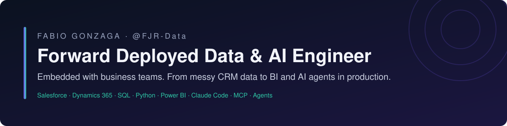

<p align="center">
  
</p>

<p align="center">
  <a href="https://www.linkedin.com/in/fgsjr"></a>
  <a href="mailto:fabio_g_da_silva@hotmail.com"></a>
  
  
</p>

## About

I'm Fabio, a data & AI engineer who works the way Forward Deployed Engineers do: I sit inside the business team that owns the problem, find the real data behind it, build the fix in *their* stack, and stay until people actually use it.

12 years across IBM, Natura, AutoZone, LinkedIn and the Autodesk ecosystem, most of them embedded in Sales Ops and commercial teams, where messy CRM data meets executive decisions. Since 2025 I've been putting LLM agents to work on that same data: MCP integrations, agent orchestration and evaluation loops.

## What I bring to an FDE seat

| What FDE teams ask for | Evidence |
|---|---|
| Customer-embedded delivery | Two back-to-back contract placements inside client Sales Ops teams (LinkedIn, Autodesk); now embedded with commercial and finance teams at an Autodesk partner |
| Messy enterprise data | Salesforce, Dynamics 365, NetSuite, HubSpot · SQL Server, PostgreSQL, Presto |
| Shipping to production | CRM audit automation, Power BI / Fabric reporting, AI-assisted CRM extraction used by business teams |
| Agent artifacts: MCP servers, sub-agents, skills | Python MCP servers (8 tools / 69 tests; 6 tools / 22 tests), 36 custom Claude Code skills, subagent pipelines, a multi-agent orchestrator with 653 automated tests |
| Evals, not vibes | Self-improving code loop that keeps a change only if its eval score goes up, otherwise reverts |
| Business framing | Category budget reallocation with Kantar / Euromonitor data: **+7.57% ROI** |

## Selected work

### Field deployments

**CRM go-live stabilization & AI-connected reporting** · *Autodesk partner, 2026–now*

- Post-migration Salesforce stabilization: data-quality rules, reconciliation of migrated records, integrations with ERP (NetSuite) and marketing automation (HubSpot).
- Replaced manual customer reports with AI-assisted Salesforce extraction; commercial BI on Power BI and Microsoft Fabric.
- Restored the LLM ↔ ERP MCP connection by fixing role and permission scopes; building the automated pipeline that moves finance teams' AI-built dashboards into SharePoint.
- Part of the internal AI-adoption program (tool rollout, use-case intake, governance); led the source-control platform decision (GitHub vs GitLab vs Azure DevOps).

**Forecast-vs-plan reporting for Brazil sales leadership** · *Autodesk (contract), 2025*

- Forecast-vs-plan reporting from Brazil sales leadership to AMER, built on Salesforce reports, Power BI and Python.
- Report refresh cut from **~4 h to ~30 min** per cycle.

**CRM hygiene audit automation** · *LinkedIn (contract), 2023–2024*

- Centralized Sales Ops audit processes on Dynamics 365 and automated the recurring CRM data-quality audits; Salesforce data validation with Presto SQL.
- **~20 h/week** of manual auditing removed per project.

**Parts-lookup analytics & catalog classification** · *AutoZone, 2021–2025*

- Customer parts-search analytics, classification of parts by usage group and similarity, and internal KPIs (Python, PostgreSQL, Alteryx, Power BI).

**Marketing budget allocation** · *Natura, 2019*

- ETL from a legacy database plus Kantar / Euromonitor market data to reallocate budget across categories: **+7.57% ROI** on the optimized allocation.

### AI engineering lab

Private repositories; I'm happy to do a live walkthrough.

| Project | What it is | Signal |
|---|---|---|
| **Agent orchestration system** | Python / asyncio orchestrator routing work to 11 specialist and generalist agents: message bus, 3-tier memory, skill registry with success tracking, retry and dead-letter queue. Model cascade: local model (Ollama) first, then headless Claude Code in Docker | 653 automated tests |
| **Domain MCP servers** | Broke the orchestrator into standalone MCP servers (finance data, calendar and tasks, agent bridge) that any MCP client can use | 8 tools / 69 tests; 6 tools / 22 tests |
| **Auto-Evolve** | An LLM proposes a code change, an eval scores it, and the change is kept (and committed) or reverted. Runs overnight on a local `qwen3-coder:30b` | PDF field extraction 0.29 → 0.57 in the first run |
| **Meeting-intelligence pipeline** | Recordings → transcripts → parallel lightweight subagents → decision log and recurring themes. Work and personal content are kept apart by deny rules | Runs daily on a schedule |
| **Model routing policy** | Routes each task to a local model or Claude by task type and stakes, to balance cost, privacy and quality | Used across all the projects above |

## Toolkit

- **AI & agents:** Claude Code (skills, subagents, headless), Model Context Protocol (Python servers), Ollama / local models, eval loops, n8n
- **Data:** SQL (SQL Server, PostgreSQL, Presto), Python (pandas, NumPy, scikit-learn), DuckDB, Power Query, Alteryx
- **BI:** Power BI / DAX, Microsoft Fabric, Tableau, Qlik Sense
- **Business systems:** Salesforce, Dynamics 365, NetSuite, HubSpot
- **Engineering:** Git, Docker, pytest, Linux / WSL2, TypeScript / Next.js (working level)
- **Market data:** Kantar, Euromonitor

## How I work

1. **Start at the decision, not at the data.** First question: who decides what, and with which number?
2. **Prototype on real data in days.** A rough version people can react to beats a perfect spec.
3. **Production or it didn't happen.** Adoption and measured impact are the deliverable.
4. **The customer's data stays in the customer's environment.** Humans approve critical actions.
5. **Write it down.** Decision logs and runbooks, so the team can run it without me.

## Career

| Period | Role | Company |
|---|---|---|
| 2026 – now | Data Governance Analyst · Digital Transformation | FF Solutions (Autodesk partner) |
| 2025 – 2026 | Sales Data Analyst (contract) | Autodesk |
| 2023 – 2024 | Data Analyst, Sales Ops (contract) | LinkedIn |
| 2021 – 2023 · 2024 – 2025 | Senior Data Analyst | AutoZone |
| 2020 – 2021 | Senior Strategy Analyst | Novaquest |
| 2019 | Junior Data Scientist | Natura |
| 2014 – 2018 | Technical Service Representative II | IBM |

**Education:** B.Sc. in Science & Technology, UFBA · MBA coursework in Business Intelligence, IGTI / XP Educação

## Currently exploring

- Agents over CRM and ERP data through MCP: scoped permissions, audit trails, failure modes (tracking the 2026-07-28 MCP spec and its tighter authorization)
- Power BI and Fabric MCP servers: letting agents query governed semantic models instead of raw tables
- Evals for agentic workflows: task-level scoring as a go-live gate
- Closing gaps that FDE postings ask for: TypeScript and a major cloud (AWS or Azure)

## Contact

Open to **Forward Deployed Engineer**, **AI Deployment / Solutions Engineer** and **data & AI consulting** roles, remote-first.

- 📧 [fabio_g_da_silva@hotmail.com](mailto:fabio_g_da_silva@hotmail.com)
- 💼 [linkedin.com/in/fgsjr](https://www.linkedin.com/in/fgsjr)
- 🌐 [DataInsight: data & AI deployment, in Portuguese](https://fjr-data.github.io/dataexp/)

```json
{
  "githubUsername": "FJR-Data",
  "fullName": "Fabio Gonzaga da Silva Junior",
  "location": "São Paulo, Brazil",
  "languages": ["pt", "en"],
  "focus": ["forward deployed engineering", "data & AI deployment", "CRM data", "LLM agents", "MCP"],
  "openTo": ["Forward Deployed Engineer", "AI Deployment Engineer", "Solutions Engineer"],
  "remote": true
}
```
